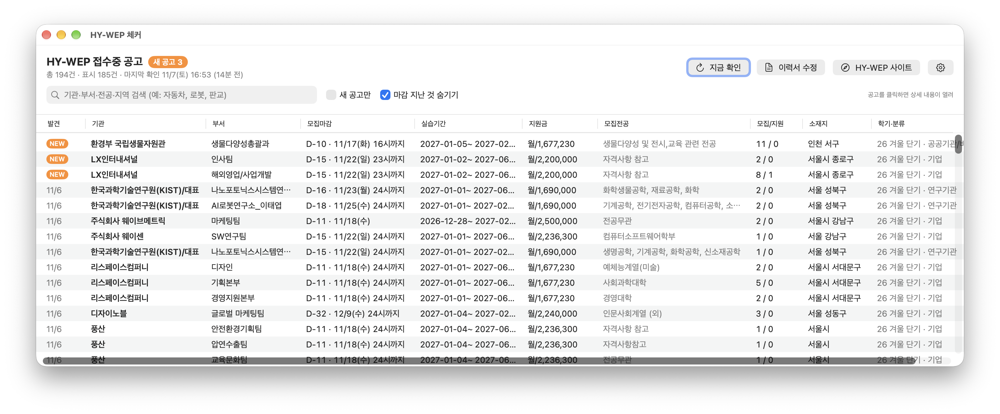
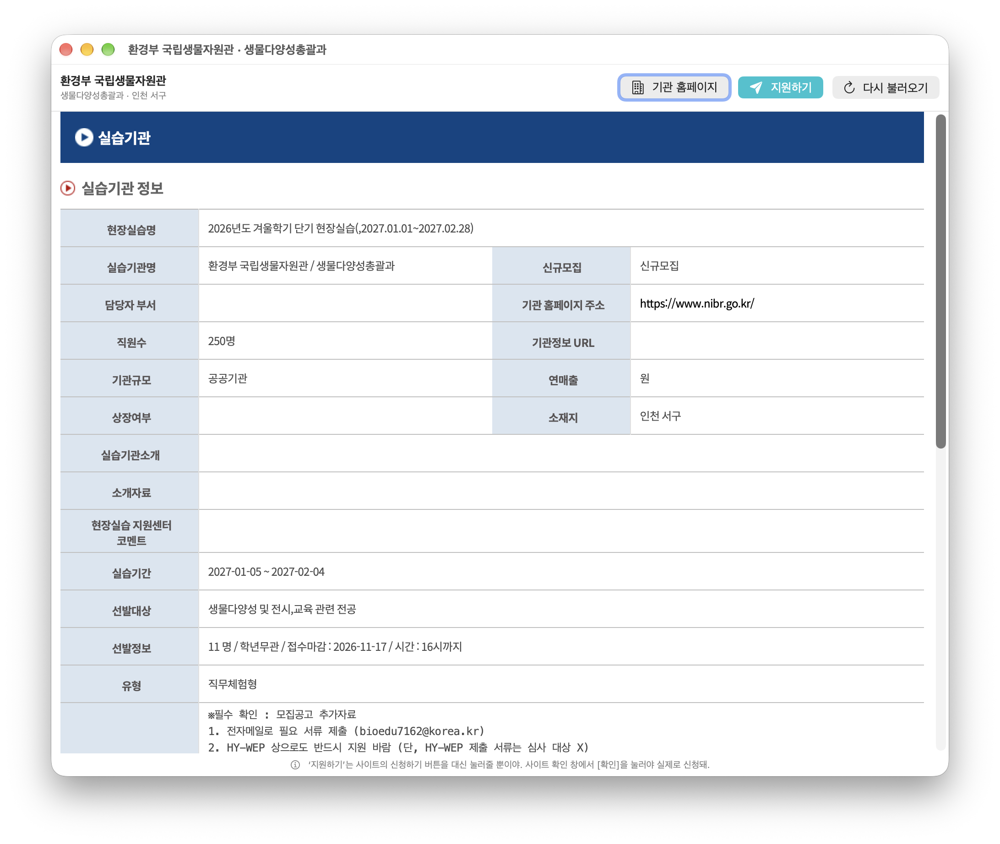
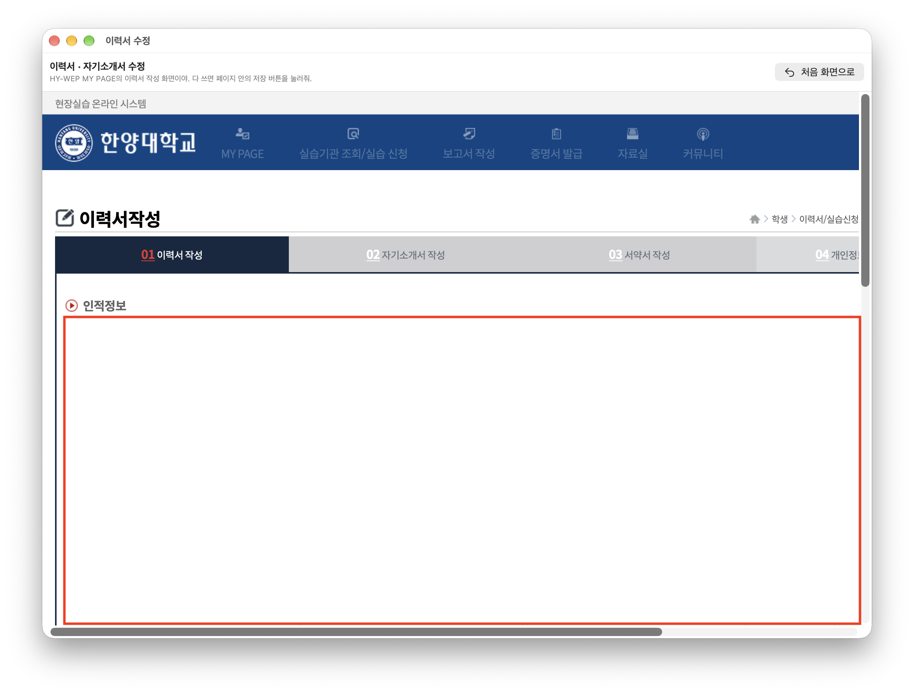

# HY-WEP 체커 — 한양대 현장실습 새 공고 알리미 (macOS)

한양대 현장실습 포털 **HY-WEP**(hywep.hanyang.ac.kr)의 **접수중 공고를 한눈에 보고, 새로 올라온 공고를 매일 알려주는** Mac 앱이에요.

- **설치하고 계정만 입력하면 끝**: 터미널이나 Python 같은 준비가 필요 없어요.
- **검색·정렬·필터**: 기관, 부서, 전공, 지역으로 찾고 마감일순으로 정렬할 수 있어요.
- **공고 클릭 → 상세 내용**: 앱 안에서 로그인된 상태로 공고 상세 페이지가 바로 열려요.
- **원하는 시각에 자동 확인**: 정해둔 시각(기본 매일 05:00, 하루 여러 번도 가능)에 확인해서 새 공고가 있으면 창과 알림으로 알려줘요.
- **자동 확인은 읽기 전용**: 공고 목록과 상세 조회만 해요. 신청은 내가 **지원하기**를 누르고 사이트 확인 창에서 [확인]을 눌렀을 때만 돼요. 취소는 절대 하지 않아요.
- **계정 정보는 내 Mac에만**: 아이디와 비밀번호는 macOS 키체인에 저장돼요.

> 학생이 개인적으로 만든 비공식 도구예요. 한양대학교와는 관련이 없어요.

---

## 목차

- [화면 미리보기](#화면-미리보기)
- [설치하기](#설치하기)
- [처음 실행하기 (설정 마법사)](#처음-실행하기-설정-마법사)
- [사용법](#사용법)
- [자동 확인 (시각 설정)](#자동-확인-시각-설정)
- [설정](#설정)
- [자주 묻는 질문 / 문제 해결](#자주-묻는-질문--문제-해결)
- [삭제하기](#삭제하기)
- [동작 방식 (개발자용)](#동작-방식-개발자용)
- [소스에서 빌드하기](#소스에서-빌드하기)

---

## 화면 미리보기

**공고 목록**: 새로 올라온 공고는 `NEW`, 나머지는 처음 발견한 날짜로 표시돼요. 위쪽에 **지금 확인**, **이력서 수정** 버튼이 있어요.



**공고 상세 창**: 공고를 클릭하면 로그인된 상태로 상세 페이지가 열리고, **지원하기**로 바로 신청할 수 있어요.



**이력서 수정 창**: 목록 화면의 **이력서 수정** 버튼을 누르면 HY-WEP 이력서 작성 화면이 앱 안에서 열려요. (개인정보 부분은 가렸어요)



- **발견** 열:
  - `NEW`: 오늘 처음 발견된 공고
  - 날짜(예: `11/7`): 그날 처음 발견된 공고. 처음 설치할 때 이미 있던 공고는 처음 확인한 날짜로 표시돼요.
- 마감 **2일 이내**인 공고는 빨간색으로 표시돼요.

---

## 설치하기

### 요구 사항

- macOS 14 (Sonoma) 이상
- Apple Silicon과 Intel Mac 모두 지원
- 한양대 포털 아이디와 비밀번호 (HY-WEP 학생 로그인에 쓰는 계정)

### 방법 A: Homebrew로 설치 (추천)

[Homebrew](https://brew.sh)를 쓰고 있다면 터미널에 아래 명령을 붙여 넣으면 끝이에요. 보안 경고도 뜨지 않아요.

```bash
brew tap anrqkdrnl/tap
brew trust anrqkdrnl/tap        # Homebrew 7 이상에서 필요해요 (예전 버전이면 생략)
brew install --cask hywep-checker
```

설치가 끝나면 응용 프로그램 폴더에서 **`HY-WEP 체커`**을 열면 돼요.

- 업데이트: `brew upgrade --cask hywep-checker`
- 삭제: `brew uninstall --cask hywep-checker` (앱 데이터까지 지우려면 `--zap`을 붙여요)

> `brew trust`는 Homebrew 공식 저장소가 아닌 tap(개인 저장소)을 믿고 쓰겠다고 등록하는 명령이에요. 이 tap에 들어 있는 설치 스크립트는 [anrqkdrnl/homebrew-tap](https://github.com/anrqkdrnl/homebrew-tap)에서 직접 확인할 수 있어요.

### 방법 B: 직접 다운로드

#### 1. 다운로드

[**Releases**](../../releases/latest) 페이지에서 `HywepChecker.zip`을 받아서 압축을 풀어요.

#### 2. 응용 프로그램 폴더로 옮기기

압축을 풀면 나오는 **`HY-WEP 체커.app`**을 **응용 프로그램** 폴더로 드래그해요.

#### 3. 처음 열기 (보안 경고 넘기기)

Apple 유료 개발자 인증을 받지 않은 앱이라서 처음 열 때 macOS가 막아요. **한 번만** 아래처럼 허용하면 돼요.

**macOS 15 (Sequoia) 이상**
1. `HY-WEP 체커`를 더블클릭해요. "열 수 없음" 경고가 뜨면 **완료**를 눌러요.
2. **시스템 설정 → 개인정보 보호 및 보안**으로 가요.
3. 아래쪽에 있는 *"HY-WEP 체커"이(가) 차단되었습니다* 옆의 **그래도 열기**를 누르고 암호를 입력해요.

**macOS 14 (Sonoma)**
- Finder에서 앱을 **우클릭 → 열기 → 열기**를 눌러요.

**터미널이 편하다면**

```bash
xattr -dr com.apple.quarantine "/Applications/HY-WEP 체커.app"
```

---

## 처음 실행하기 (설정 마법사)

1. **환영** 화면에서 **시작하기**를 눌러요.
2. **계정 연결**: 한양대 포털 아이디와 비밀번호를 입력하고 **로그인 확인**을 눌러요. 앱 안에서 HY-WEP에 실제로 로그인해 보고, 성공해야만 키체인에 저장해요.
3. **자동 확인**: **자동 확인**(확인 시각 포함)과 **알림 받기**를 고르고 **완료하고 지금 확인**을 눌러요.
   - 첫 확인 때 지금 접수중인 공고 전체를 **기준 목록**으로 저장해요.
   - 다음부터는 기준 목록 이후에 새로 올라온 공고만 `NEW`로 표시돼요.

---

## 사용법

| 하고 싶은 것 | 방법 |
|---|---|
| 지금 다시 확인 | **지금 확인** 버튼 또는 **⌘R** (10~20초) |
| **공고 상세 보기** | 목록에서 공고를 **클릭**하면 상세 창이 열려요. 다른 공고를 클릭하면 같은 창에서 바뀌고, 키보드 ↑↓로 넘겨 보면서 볼 수도 있어요. |
| 검색 | 위쪽 검색칸에 입력해요. 기관, 부서, 모집전공, 소재지, 분류, 학기를 한 번에 찾아요. 예: `자동차`, `로봇`, `판교`, `공공기관` |
| 새 공고만 보기 | **새 공고만** 체크 |
| 마감 지난 공고 보기 | **마감 지난 것 숨기기** 체크 해제 |
| 정렬 | 열 제목을 클릭해요. 다시 누르면 순서가 반대로 바뀌어요. 기본은 최신 등록순이에요. |
| 그 밖의 메뉴 | 공고를 **우클릭**하면 상세 보기, 기관 홈페이지 열기, 기관명 복사가 있어요. |
| 긴 글 전체 보기 | 모집전공이나 기관명 칸 위에 마우스를 올려요. |
| 신청하기 | 공고 상세 창의 **지원하기** 버튼을 눌러요. 아래 [지원하기](#지원하기)를 참고해요. |

### 공고 상세 창

- 앱이 로그인한 상태로 HY-WEP 공고 상세 페이지를 그대로 보여줘요. 실습기관 정보, 실습 내용, 모집 조건, 지원금 같은 내용이 있어요.
- 로그인이 풀려 있으면 자동으로 다시 로그인한 뒤에 열어요. 몇 초 걸릴 수 있어요.
- 위쪽 버튼:
  - **기관 홈페이지**: 공고에 등록된 기관 홈페이지를 브라우저로 열어요.
  - **지원하기**: 이 공고에 신청해요. 아래를 참고해요.
  - **다시 불러오기**: 다시 로그인해서 공고를 새로 열어요.

### 이력서 수정

목록 화면 위쪽 **지금 확인** 옆의 **이력서 수정**을 누르면, 앱 안 창에서 HY-WEP 이력서 작성 화면이 열려요.

- HY-WEP은 이력서 화면 주소로 바로 들어가는 걸 막아요. 그래서 앱이 로그인해서 **MY PAGE → 이력서 작성** 버튼을 대신 눌러 열어줘요.
- 이력서, 자기소개서, 서약서, 개인정보 동의서를 여기서 작성해요. 다 쓰면 **페이지 안의 저장 버튼**을 눌러야 저장돼요.
- 사진 같은 파일 첨부와 사이트의 확인 창도 그대로 떠요.
- **처음 화면으로**를 누르면 이력서 화면을 다시 열어요. 저장하지 않은 내용은 사라져요.
- 이력서와 자기소개서를 다 작성해야 **지원하기**로 신청할 수 있어요.

### 지원하기

1. 공고 상세 창에서 **지원하기**를 눌러요.
2. 앱이 HY-WEP 접수중 목록에서 그 공고 줄을 찾아 주황색으로 표시하고, 사이트의 **신청하기** 버튼을 대신 눌러요.
3. HY-WEP 사이트가 띄우는 **확인사항 창**에서 **확인**을 눌러야 실제로 신청돼요. **취소**를 누르면 아무 일도 일어나지 않아요.
4. 결과(`신청 되었습니다.` 등)도 사이트가 띄우는 창으로 보여줘요.

- 이력서·자기소개서를 아직 작성하지 않았으면 사이트가 `이력서 및 자기소개서를 먼저 작성완료해주세요.`를 띄우고 신청되지 않아요. HY-WEP 사이트에서 먼저 작성해 주세요.
- 이미 신청한 공고처럼 **신청하기** 버튼이 없으면 누르지 않고 안내만 보여줘요.
- **공고 내용으로 돌아가기**를 누르면 다시 상세 내용을 보여줘요.
- 복수 지원 불가 같은 학교 규정은 사이트 확인사항 창에 나오는 내용을 꼭 확인해 주세요.

---

## 자동 확인 (시각 설정)

- **확인 시각은 직접 정해요.** 설정(⌘,) → **자동 실행**에서 시각을 바꾸거나, **시각 추가**로 하루 최대 6번까지 넣을 수 있어요 (예: `07:30`, `13:00`, `19:00`). 기본값은 `05:00` 하루 1번이에요.
- 앱이 macOS에 작은 예약 작업(LaunchAgent)을 등록해요. 이 작업이 10분마다 앱을 잠깐 깨워서, **정한 시각이 지났는데 아직 확인 안 한 회차가 있으면** 1번 확인해요. 그래서 실제 확인은 정한 시각부터 10분 안에 이뤄져요.
- 그 시각에 Mac이 잠자고 있었으면 깨어난 뒤 처음 쓸 때 확인해요. 여러 회차를 놓쳤어도 1번만 확인해요.
- 그 사이에 **지금 확인**을 눌렀다면 그 회차는 이미 확인한 걸로 쳐요.
- **새 공고가 있으면**: 알림을 보내고(예: `HY-WEP 새 공고 3건 — (주)로보티즈, …`) 목록 창을 띄워요. NEW 표시를 보면 돼요.
- **새 공고가 없으면**: `새 공고 없음 (접수중 194건)` 알림만 보내고 조용히 끝나요.
- 일시적인 오류는 10분 뒤에 다시 시도하고, 3번째에도 실패하면 알려줘요. 로그인 거부는 계정이 잠기지 않도록 바로 알려주고 그날 남은 회차는 건너뛰어요.

---

## 설정

설정 화면은 ⚙ 버튼이나 **⌘,**로 열어요.

| 항목 | 설명 |
|---|---|
| 한양대 포털 계정 | 아이디와 비밀번호를 변경해요. |
| 자동 확인 | 자동 실행을 켜거나 끄고, 확인 시각을 추가·변경·삭제해요. |
| 기준 목록 초기화 | 지금까지 본 공고 기록을 지우고, 현재 공고로 기준 목록을 다시 만들어요. |
| 오류 기록 보기 / 데이터 폴더 열기 | 문제가 생겼을 때 확인해요. |
| 처음 설정 다시 하기 | 설정 마법사를 다시 실행해요. |

---

## 자주 묻는 질문 / 문제 해결

**Q. 비밀번호는 어디에 저장되나요?**
macOS 키체인(`hyu-portal-id`, `hyu-portal-pw`)에 저장돼요. 앱은 이 비밀번호를 한양대 통합 로그인 페이지(`api.hanyang.ac.kr`)에 입력할 때만 써요.

**Q. 공고를 클릭했는데 "로그인 중…"에서 오래 걸려요.**
앱을 켜고 처음 여는 공고이거나, 마지막 로그인 뒤 20분이 지나면 다시 로그인해야 해서 몇 초 더 걸려요. 계속 안 되면 **다시 불러오기**를 눌러 보세요.

**Q. "로그인 후에도 공고 목록이 안 보여"라고 나와요.**
비밀번호가 틀렸거나, 포털 비밀번호를 바꿨거나, HY-WEP이 점검 중일 수 있어요. 설정에서 계정을 다시 저장해 보세요.

**Q. "접수중 공고가 0건"이라고 나와요.**
HY-WEP 사이트 구조가 바뀌었을 가능성이 커요. 이슈를 남겨 주세요.

**Q. 모든 공고가 NEW로 떠요 / NEW가 안 떠요.**
설정의 **기준 목록 초기화**로 기준을 다시 잡을 수 있어요.

**Q. 예전 터미널(Python) 버전을 쓰고 있었어요.**
- 예전 버전에서 본 공고 기록(`~/.hywep_check/seen.json`)은 처음 실행할 때 자동으로 가져와요.
- 예전 버전의 자동 실행을 끄지 않으면 팝업이 두 번 떠요. `~/Library/LaunchAgents`에 있는 예전 plist를 `launchctl bootout`으로 내리고 지워 주세요.
- 예전 코드는 [`legacy-python/`](legacy-python/)에 있어요.

---

## 삭제하기

**Homebrew로 설치했다면**

```bash
brew uninstall --cask hywep-checker          # 앱 + 자동 실행 등록 삭제
brew uninstall --zap --cask hywep-checker    # 앱 데이터와 설정까지 삭제
```

키체인에 저장된 계정 정보는 Homebrew가 지우지 않아요. 완전히 지우려면 `security delete-generic-password -s hyu-portal-id; security delete-generic-password -s hyu-portal-pw`를 실행해요.

**직접 다운로드했다면**

1. 설정에서 **자동 확인**을 꺼요.
2. `HY-WEP 체커.app`을 휴지통으로 옮겨요.
3. (선택) 데이터와 계정 정보도 지우려면:

   ```bash
   rm -rf ~/Library/Application\ Support/HY-WEP\ 체커
   defaults delete io.github.anrqkdrnl.hywepchecker
   security delete-generic-password -s hyu-portal-id; security delete-generic-password -s hyu-portal-pw
   launchctl bootout gui/$(id -u)/io.github.anrqkdrnl.hywepchecker.auto 2>/dev/null
   rm -f ~/Library/LaunchAgents/io.github.anrqkdrnl.hywepchecker.auto.plist
   ```

---

## 동작 방식 (개발자용)

```
HY-WEP 체커.app ─ (보이지 않는) 앱 안 브라우저(WKWebView)
   1. 목록 페이지가 이미 열리면(세션 유지) 바로 사용
      아니면 index.do → topLogin('1') (사이트의 '학생 로그인' 버튼과 같은 흐름)
           → api.hanyang.ac.kr 통합 로그인(#uid/#upw) → hywep으로 돌아옴
   2. 진행중 학기 탭 전부 × '접수중'(status_comp=1047) 목록을 POST /compjoinsearch/list.do로 페이지마다 조회
   3. seen.json(공고 ID → 처음 발견한 날)과 비교 → NEW 판별 → latest.json → 화면

공고 클릭 → 상세 창(WKWebView, 같은 쿠키 저장소)
   → POST /compjoinmanage/view_stu.do (jid_seq=공고 ID)
     사이트의 goView()가 하는 요청과 같아요. 세션이 끊겼으면 다시 로그인한 뒤 열어요.

launchd (10분마다) → HY-WEP 체커 --auto → 확인 시각 회차 가드 → 위 과정 → 새 공고 있으면 창 + 알림
```

### 파일 위치

| 경로 | 내용 |
|---|---|
| `~/Library/Application Support/HY-WEP 체커/latest.json` | 마지막 결과 |
| `~/Library/Application Support/HY-WEP 체커/seen.json` | 지금까지 본 공고 ID → 처음 발견한 날짜 |
| `~/Library/Application Support/HY-WEP 체커/error.log` | 오류 기록 |
| `~/Library/LaunchAgents/io.github.anrqkdrnl.hywepchecker.auto.plist` | 자동 실행 등록 |
| 키체인 `hyu-portal-id` / `hyu-portal-pw` | 포털 아이디 / 비밀번호 |

---

## 소스에서 빌드하기

Xcode가 필요해요. Command Line Tools만 있으면 SwiftUI 매크로가 없어서 빌드가 실패해요.

```bash
git clone https://github.com/anrqkdrnl/hywep-checker.git
cd hywep-checker
./build.sh --install     # 빌드 + /Applications 설치
./build.sh --zip         # 배포용 build/HywepChecker.zip
```

```
hywep-checker/
├── build.sh               # 빌드 / 설치 / zip
├── VERSION
├── app/
│   ├── HywepApp.swift     # 로그인·수집 엔진, 목록/상세 화면, 자동 실행 흐름
│   ├── Shared.swift       # 앱 안 브라우저, 키체인, launchd, 설정 마법사, 공용 뷰
│   ├── make_icon.swift
│   └── build_bundle.sh    # swiftc로 universal 앱 번들 생성 + ad-hoc 서명
└── legacy-python/         # 예전 터미널(Python + Playwright) 버전
```

개발용 플래그:
- `HywepChecker --selftest [--detail]`: 로그인, 수집, 재로그인, 상세 페이지를 점검하고 요약을 출력해요. 저장은 하지 않아요.
- `--auto`: launchd가 쓰는 모드예요.
